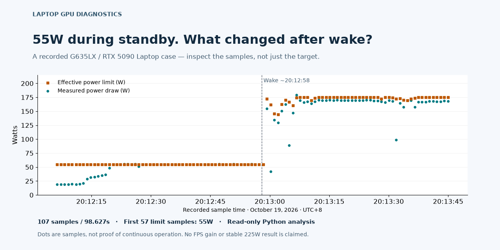

# Laptop GPU Power & Stability Diagnostics

[](https://github.com/yirancheng12-design/ROG_GPU_Diagnosis_20261019/actions/workflows/verify.yml)

[English](README.md) · [简体中文](README.zh-CN.md)

**Understand GPU power drops, separate configured limits from measured performance, and inspect the evidence yourself.** Start with three short guides, then explore the original reports and data.

The first case is an **ASUS ROG Strix SCAR 16 G635LX / RTX 5090 Laptop GPU**, recorded on **October 19, 2026 (UTC+8)**. Findings describe that machine and test session; the read-only analysis workflow can be reused with other recorded telemetry.



The preview uses the original 107-sample CSV. [Source and chart provenance](assets/preview-provenance.json) are included.

## What are you trying to understand?

| Question | Start here | What you get |
| --- | --- | --- |
| Why did the GPU limit drop to 55W? | [55W and Modern Standby](docs/en/case-55w.md) | Event timeline, invalid-run explanation, and a command to inspect the recorded CSV |
| Did the 225W experiment actually work? | [175W vs. 225W: what the logs prove](docs/en/case-225w.md) | Request vs. read-back vs. load-testing evidence, including the missing follow-up |
| How can I document my own problem? | [Reproducible diagnostic workflow](docs/en/diagnostic-workflow.md) | Checklist, blank CSV template, read-only analyzer, and a contribution format |

## Three findings to take away

- **55W coincided with standby.** The next sample after wake returned to 172.52W, then approached 175W. That supports standby involvement in this case, not a universal cause of low GPU power.
- **The awake run still failed its CPU-temperature guard.** It reached 104°C and did not finish; it cannot be used as a successful tuned benchmark.
- **A 225W target was not a stable 225W result.** The packaged pre-restart write left both live limits at 175W. The original HTML's later banner links to a missing report, so its later claims remain unverified here.

## Try the read-only analysis

Clone/download the repository. With Python 3.11+, run from its root:

```console
python tools/demo.py
```

The demo prints a compact summary directly from the preserved archive:

```text
Samples: 107 over 98.627 seconds
First limit segment: 55 W across 57 samples
Recorded limit range: 55–175 W
```

For all metric statistics and recorded limit segments:

```console
python tools/summarize_telemetry.py --zip "ROG_G635LX_调校证据.zip" --member "tuning/baseline-auto-1/telemetry.csv"
```

This prints sample statistics and recorded limit segments directly from the archive. It does not query the GPU, change settings, execute archived scripts, or require administrator access. Power draw and power limit stay separate; no FPS improvement or stability conclusion is inferred. For your data, use the [CSV template and column guide](docs/en/diagnostic-workflow.md).

## Go deeper

| Document | Contents |
| --- | --- |
| [Full GPU diagnosis](docs/en/gpu-diagnosis.md) | Hardware, initial 175W limit, 85 passive samples, stability events, and methodology |
| [Full tuning and baseline report](docs/en/tuning-report.md) | Cyberpunk runs, excluded results, temperature stops, and restoration checks |
| [Detailed 225W chronology](docs/en/power-225w-retest.md) | Driver/API failures, later registry experiment, and evidence boundaries |
| [Evidence guide and downloads](docs/en/evidence-guide.md) | Three ZIPs, original CSVs, raw-data identifiers, and package limitations |
| [Reference coverage](docs/en/evidence-coverage.md) | Which historical links resolve to archive members and which are unpublished |

## Verify and contribute

```console
python tools/verify_repository.py
python -m unittest discover -s tests -v
```

The standard-library verifier checks **10 preserved original files and 228 ZIP members**, CSV inventories, maintained documentation links, and generated reference coverage. Windows/Linux CI runs the checks. Integrity checks do not establish sensor accuracy or hardware safety.

Have another laptop or a reproducible case? [Submit a measurement](https://github.com/yirancheng12-design/ROG_GPU_Diagnosis_20261019/issues/new?template=measurement.yml), including conditions, data, exclusions, and unknowns. See [Contributing](CONTRIBUTING.md) for evidence and translation rules. No completed matched 175W/225W performance comparison is published here.

If this workflow helps you, consider starring the repository so you can find it again. Useful bug reports, corrections, and comparable measurements are equally welcome.

Maintainers can use the [sharing drafts](docs/en/share-kit.md), [growth-observation log](docs/en/growth-playbook.md), [draft release checklist](docs/en/release-notes.md), and [change log](CHANGELOG.md). These files do not publish a post or release automatically.

## Preserved Chinese sources

The [original overview](README_225W_整理说明.md), [diagnosis](ROG_G635LX_GPU诊断报告.html), [tuning report](ROG_G635LX_调校执行报告.html), [baseline log](GPU调校基线与操作记录.txt), and [retest](ROG_G635LX_225W复试结果.html) remain unchanged. English editions reorganize the readable narratives; raw logs, filenames, screenshots, and archive contents retain their original identifiers and language. Download original HTML files to view their layouts.

This is a diagnostic evidence project, not a validated over-spec tuning profile. The historical record includes real software/configuration changes; their archived scripts and backups are evidence, not instructions for another laptop.

## License

Original code and documentation in this repository are licensed under the [MIT License](LICENSE). Third-party software, firmware, screenshots, and other third-party material in the evidence archives retain their respective rights and licenses; they are not relicensed by this notice.
