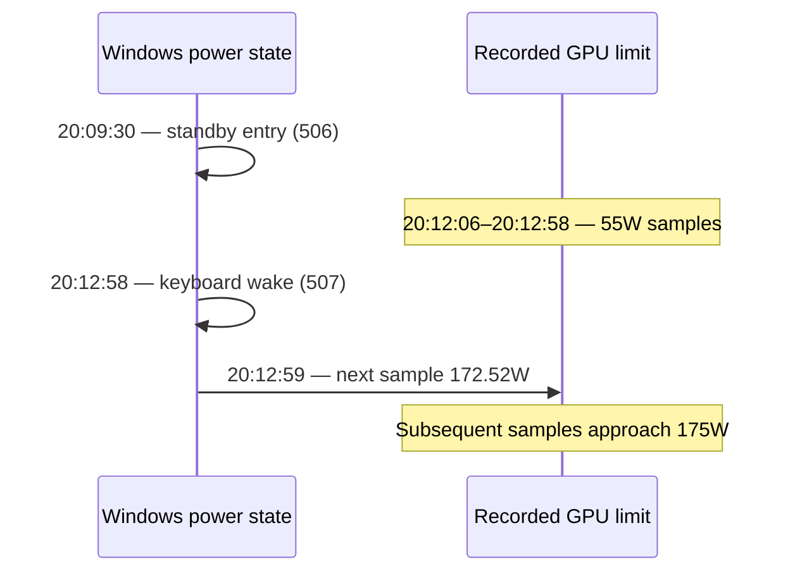

# Why did the RTX 5090 Laptop drop to a 55W power limit?

[Home](../../README.md) · [Full tuning report](tuning-report.md) · [Reusable workflow](diagnostic-workflow.md)

**Finding:** in this October 19, 2026 G635LX case, a 55W GPU limit coincided with Modern Standby. The next sample after wake returned to 172.52W, then approached 175W. A later awake run did not repeat the 55W episode, but it stopped on CPU temperature. That supports standby involvement; it does not establish every low-power laptop issue as the same fault.

## The timeline

All times are Asia/Shanghai (UTC+8). This diagram shows recorded events and samples, not a continuously measured power trace.



| Observation | What it tells us | What it does not tell us |
| --- | --- | --- |
| A 55W limit and approximately 577–667MHz load clocks | A reduced limit occurred during this run | The adapter was defective, or a firmware flash was needed |
| Limit rose immediately after wake | Strong temporal evidence of standby involvement | The internal driver/firmware mechanism was fully identified |
| Awake run showed 169.85–175W and no repeat 55W interval | Removing standby interference changed the observed conditions | The laptop became stable or gained a measured overclock benefit |
| CPU reached 104°C in the awake run | The recorded CPU stop guard was exceeded | The GPU itself hit a thermal-protection threshold |

## Why the FPS numbers are not an improvement claim

The standby-affected run reported **29.6961 average FPS / 8.9895 1% low**. It was excluded from performance comparison. The earlier preliminary run reported **36.0848 average FPS / 32.279 1% low**, but used a different cap and lacked continuous CPU monitoring. The later awake run did not finish.

These are not matched before/after tuning results. Fixing a disturbed test condition cannot be counted as a proven overclock gain.

## Inspect the data yourself

Download the [tuning evidence ZIP](../../ROG_G635LX_调校证据.zip) into the repository root, where it already exists in a full clone. With Python 3.11+:

```console
python tools/summarize_telemetry.py --zip "ROG_G635LX_调校证据.zip" --member "tuning/baseline-auto-1/telemetry.csv"
```

The command reads one CSV directly from the ZIP, prints JSON sample statistics and runs of equal recorded power-limit values, and does not extract or execute anything. `limit_W` and `power_W` are separate metrics. Missing values remain missing; gaps are not interpolated.

For that exact archived CSV, the analyzer reads **107 samples spanning 98.627 seconds**. The first **57 samples** have a 55W limit, from **20:12:06.326 to 20:12:58.317**. After the 172.52W sample at **20:12:59.261**, the limit fluctuates before reaching 175W; it does not immediately become a perfectly flat 175W trace. Whole-file means include low-load and transition samples and should not be labeled sustained benchmark power.

To correlate the output, inspect these members in the same package:

- `tuning/baseline-auto-1/standby-events.json` — power-state events; distinguish event IDs and timestamps.
- `tuning/baseline-auto-1/analysis.json` — the excluded run's analysis.
- `tuning/baseline-awake-1/telemetry.csv` and `session.json` — the separate awake run and stop record.

## Apply the method to another machine

Start with read-only observations: record the active profile, AC/battery state, effective limit, actual draw, utilization, temperatures, and time-matched power events. Preserve the original configuration. A low draw at low utilization is not evidence of a low limit. A matching event timeline is useful evidence, but separate causes must still be considered.

Use the [diagnostic checklist and blank CSV template](diagnostic-workflow.md) to document your own case. This case study is not a universal standby fix or a validated tuning profile.
